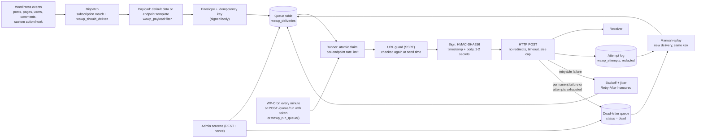

<p align="center"></p>

<p align="center">
  
  
  
</p>

# Webhook Automations for WordPress

> Send signed, reliable webhooks from WordPress events, with retries, replay protection and a delivery log.

A WordPress plugin that turns site events into signed webhooks to endpoints you configure. It queues deliveries, retries failures with exponential backoff and jitter, gives every delivery an idempotency key so receivers can de-duplicate, signs every request (HMAC-SHA256 over timestamp and body) so receivers can verify it, moves exhausted deliveries to a dead-letter queue, and keeps a searchable delivery log that redacts sensitive fields and supports manual replay.

**Quick links:** [Architecture](#architecture) · [Tech stack](#tech-stack) · [Engineering decisions](#engineering-decisions) · [Roadmap](#roadmap) · [Getting started](#getting-started) · [Verification](#verification) · [Webhook reference](docs/webhook-reference.md) · [Case study](docs/case-study.md) · [Research report](docs/research-report.md)

> **Public showcase.** This repository holds the documentation, client case study, research report and measured results for this product. The runnable source code is distributed separately under a license: see [SOURCE-ACCESS.md](SOURCE-ACCESS.md).

## At a glance

|  |  |
|---|---|
| **Track** | Business · Advanced |
| **Phase** | Beta: all five milestones (M1 to M5) work in real WordPress (WordPress Playground, WebAssembly), the automated tests pass, and all four experiments have recorded results. Not production-tested: no real third-party receiver, no MySQL or MariaDB, no multisite, and no live site traffic. See [What was and was not tested](#what-was-and-was-not-tested). |
| **Version** | 0.1.0 (installable ZIP built by `npm run package`) |
| **Primary reader** | Clients and founders |
| **Read next** | [Webhook reference](docs/webhook-reference.md) · [Client case study](docs/case-study.md) · [Research report](docs/research-report.md) |

## Why this exists

Connecting WordPress to other tools usually means fragile one-off code or a paid middleman. Webhooks get lost when a receiver is down, cannot be verified by the receiver, and nobody can tell what was sent or why it failed.

## What it does (built and tested)

- **Event catalogue:** post and page published, updated, trashed and deleted; user registered; comment created and approved; and a generic custom hook (`do_action( 'wawp_trigger', 'name', $data )`) for anything else. Every event is triggered from real WordPress actions in the test suite and its payload is checked against a documented JSON schema.
- **Signing:** HMAC-SHA256 over `timestamp + "." + raw body`, a fresh timestamp on every attempt, secret rotation with a grace period (two signatures while rotating), and a zero-dependency Node reference verifier with replay protection.
- **Delivery queue** in a custom table; delivery is **at-least-once**. Retries use exponential backoff with jitter, honour `Retry-After`, and end in a dead-letter queue. Every delivery has a stable idempotency key; exactly-once *effects* need receiver-side de-duplication on that key (tested that way).
- **Delivery log** with redaction of sensitive keys and e-mail addresses, search, retention limits and one-click replay (a new delivery with the same idempotency key).
- **Payload templates** (JSON with `{{ placeholders }}` and a few filters), developer filters, and **per-endpoint rate limits**.
- **Admin interface** (endpoints, test delivery, deliveries, dead-letter queue, queue health and queue age, settings) and a REST API; the queue can be run by WP-Cron or from a real cron job through a token-protected route or the `wawp_run_queue()` function.
- **Endpoint safety (SSRF):** https only, no private or loopback targets by default (explicit local-testing opt-in), no redirects, capped timeout, secrets shown once and stored encrypted, never written to the log.

The signature scheme, headers, retry policy, hooks and REST routes are documented in the [webhook reference](docs/webhook-reference.md).

## Not built yet / out of scope

| Item | Why |
|---|---|
| Licence keys, a licence server, an update server or any phone-home | The commercial layer is deliberately out of scope. The plugin is GPL-2.0-or-later, makes no calls to its author and has no telemetry. |
| Integrations with WooCommerce, form plugins or other third-party plugins | Not built and not tested. They can send events through the documented generic custom hook. |
| Custom event types beyond post and page, per-endpoint custom HTTP headers, authentication schemes other than the signature | Not needed for the scope; can be added later. |
| Alerting (e-mail or chat) on queue age or failures | The health screen and `GET /health` expose the numbers; alerting is not built. |
| WP-CLI command | A PHP function and a REST route are provided instead. |
| Multisite and network activation | Not built and not tested. |
| MySQL or MariaDB verification | Tests ran only on the SQLite database layer that WordPress Playground uses. The SQL is plain and uses `$wpdb->prepare`, but it has not been run on MySQL here. |
| Inbound webhooks, a visual workflow builder | Outside the product. |
| WordPress Coding Standards (PHPCS) compliance | PHP is not installed on the build machine, so PHPCS could not run. WPCS compliance is **not** claimed. |

## Architecture



## Tech stack

| Layer | Technology (what was actually used) |
|---|---|
| Plugin language | PHP; header says Requires PHP 7.4. `php -l` passes on PHP 7.4.33 and 8.5.10 (php-wasm); the full test suite ran on PHP 8.3 and on PHP 7.4 |
| WordPress | Hooks, REST API (`wawp/v1`), WP-Cron, `wp_remote_post`, custom tables with `dbDelta` and `$wpdb->prepare`, libsodium secretbox (WordPress ships a polyfill) for secrets at rest |
| Admin UI | Server-rendered PHP screens, vanilla JavaScript and CSS (no build step), REST calls with the WordPress nonce |
| Test runtime | WordPress Playground CLI 3.1.60 (WordPress and PHP compiled to WebAssembly, under Node) on a SQLite database layer |
| Test harness | Node (built-in `node:test`), a local Node receiver that verifies signatures and injects seeded failures, a must-use plugin used only in tests, Ajv for JSON Schema |
| Reference verifier | Node, no dependencies (`verifier/webhook-verifier.mjs`) |
| Packaging | Installable ZIP built by `tools/package.mjs` (fflate), GPL-2.0-or-later, `readme.txt`, clean uninstall |
| CI | GitHub Actions workflow with the same commands as the local ones (**written but never run**) |

## Engineering decisions

### Delivery is at-least-once, made safe by idempotency

Retries can deliver the same event twice (for example when the receiver processed the request but the response was lost). Every delivery carries a stable idempotency key inside the signed body and in a header. A receiver that stores the keys gets exactly-once effects. The plugin does not claim exactly-once delivery.

### The log is useful and safe

The log stores a redacted copy of each payload plus every attempt. The raw payload is kept separately and only for replay, for a configurable number of days, then purged; after that the redacted copy remains and replay is refused. Signing secrets are encrypted at rest, shown once, and a database scan in the tests finds them nowhere.

### Honest about WP-Cron

WordPress's scheduler only runs when the site receives requests. The plugin documents this, supports a real-cron trigger, and reports queue age and a stalled flag so a quiet site does not silently stall deliveries. Retry timing is verified with an injectable clock and accelerated time (see below), which does not measure real waiting.

### The accelerated clock cannot weaken production

The queue reads time through `Wawp_Clock`. A stored offset and a random seed are honoured **only** when the constant `WAWP_TEST_CLOCK` is defined as `true` by code that runs before the plugin (a must-use plugin in the tests). The plugin never defines it, and no option, request parameter or filter can enable it. Tests show that a stored offset of 99999 seconds is ignored in a WordPress without the constant (both in the main test instance and in a fresh WordPress where the ZIP was installed).

### SSRF protection

Endpoint URLs must be https and public (private, loopback, link-local, reserved and numeric-trick addresses are refused), the check runs again before every send, and redirects are never followed. A hostile DNS server could still answer differently between the check and the connection (DNS rebinding); this is a documented residual risk.

## Quality bar

- Automated tests against real WordPress for every milestone, including failure injection, signature and replay cases, event coverage, SSRF, redaction, retention, rate limits, admin screens, REST access control (anonymous, subscriber, missing nonce) and uninstall.
- A **heuristic** static scan (pattern matching, not an audit) asserts the ABSPATH guard, a `permission_callback` on every route, nonce and capability checks on any admin-post or AJAX handler (none are registered; REST is used), prepared SQL, no `eval` or shell calls, a consistent text domain, one HTTP call site, no telemetry, and no absolute local paths in the repository.
- The admin JavaScript was exercised by hand in the Claude desktop app's built-in browser (create endpoint with one-time secret, send test, edit, view delivery). That check is not automated.

## What was and was not tested

| Area | Tested | Not tested |
|---|---|---|
| WordPress | 7.1.3 on PHP 8.3 and on PHP 7.4, and 6.0.17 on PHP 7.4, each with 66 of 66 test cases passing; PHP 8.5.10 only for `php -l` | Any other version; PHP 8.0 to 8.2 and 8.4; multisite |
| Database | SQLite layer of WordPress Playground | MySQL, MariaDB |
| HTTP | **Real** outbound `wp_remote_post` from the WebAssembly WordPress to a local Node receiver on 127.0.0.1 (no transport workaround was needed) | Public internet targets, TLS certificate handling, real third-party receivers |
| Failures | Simulated by the local receiver on a seeded schedule | Real-world outages |
| Retry timing | Schedule logic in accelerated time (injectable clock) | Real wall-clock waiting; WP-Cron behaviour on a site with no traffic |
| WP-Cron | Natural spawn by Playground, a direct `wp-cron.php` request, and the token route all ran the queue | Hosts that disable loopback requests |
| Packaging | ZIP uploaded through wp-admin "Upload Plugin", activated, used, deactivated and deleted; uninstall removed tables, options and scheduled events | Network install |
| Code standards | `php -l` on 7.4 and 8.5; heuristic scan | PHPCS / WPCS (no PHP toolchain here) |

## Roadmap

- [x] M1: plugin skeleton, endpoints, event catalogue, clean uninstall (tests: `m1-skeleton`, `events`, ZIP install test)
- [x] M2: queue, delivery and the delivery log (tests: `m2-delivery`)
- [x] M3: HMAC signing, timestamps, replay window and secret rotation, plus the Node reference verifier (tests: `m3-signing`, `verifier.unit`, experiment E3)
- [x] M4: retries with backoff and jitter, dead-letter queue, idempotency keys and manual replay, WP-Cron and real-cron trigger (tests: `m4-retries`, experiments E1 and E2)
- [x] M5: payload templates, filters, rate limits and the admin interface (tests: `m5-features`, `security`)
- [x] Experiments E1 to E4 run once, in one invocation, with results in `results/`
- [ ] Verified on MySQL or MariaDB
- [ ] Verified against a real third-party receiver and on a live site
- [ ] WordPress Coding Standards run (needs a PHP toolchain)
- [ ] Commercial layer (licensing, updates): out of scope by decision

## Getting started

> _These instructions refer to the source package, which is distributed separately and is not part of this showcase repository._

Requirements: Node 20 or newer and npm. No PHP, MySQL, Composer or Docker is needed; WordPress runs in WordPress Playground (WebAssembly). The first WordPress start downloads WordPress and can take several minutes. On Windows, install from a short path (for example a folder directly under your temp directory): long paths can break tooling.

**1. Install the development tooling** (this is what the commands below were run with):

```
npm ci
```

**2. Build the installable plugin ZIP:**

```
npm run package
```

This writes `dist/webhook-automations-wp-0.1.0.zip` (top-level folder `webhook-automations-wp/`, built only from `plugin/webhook-automations-wp/`).

**3. Install the ZIP in WordPress.** In a normal WordPress site: Plugins, Add New, Upload Plugin, choose the ZIP, Install Now, Activate. Then open **Webhooks** in the admin menu, add an endpoint (https URL), copy the signing secret (shown once) and use **Send test**. To try it locally without installing WordPress, run the packaged-install test, which performs exactly that flow in a fresh Playground WordPress:

```
npm run test:package
```

**4. Try the plugin in a local Playground WordPress** (the plugin folder is mounted and activated; the test-only must-use plugin is also mounted, so use this for development only):

```
npm run wp:start
```

Then open `http://127.0.0.1:9430/wp-admin/` (the Playground test site's default administrator is `admin` with password `password`; it exists only inside that throwaway local site). Stop it with `npm run wp:stop`. For a local receiver, enable "Allow private, loopback and plain-http endpoints" in Settings.

## Verification

> _These instructions refer to the source package, which is distributed separately and is not part of this showcase repository._

Every command below was run from a clean state in a short path; results are in `results/`.

| Command | What it does |
|---|---|
| `npm run lint:php` | `php -l` on every PHP file with php-wasm at PHP 7.4 and 8.5 (`results/php-lint.json`) |
| `npm run test:unit` | Verifier, statistics, schema and heuristic static-scan tests (no WordPress needed) |
| `npm test` | Starts one Playground WordPress on PHP 8.3 (PID recorded, stopped by that PID), runs every test file against it |
| `npm run test:php74` | The same tests on PHP 7.4 |
| `npm run test:wp60` | The same tests on WordPress 6.0.17 with PHP 7.4 |
| `npm run package` then `npm run test:package` | Builds the ZIP, installs it through wp-admin Upload Plugin in a fresh WordPress, activates, deactivates, deletes, asserts uninstall |
| `npm run experiments` | Experiments E1 to E4 in one resumable invocation; raw results in `results/*-raw.jsonl`, summaries in `results/*-summary.json`, run record in `results/run-metadata.json` |
| `npm run experiment:e1` (`e2`, `e3`, `e4`) | One experiment |
| `npm run report` | Prints Markdown tables from `results/` |

`WAWP_QUICK=1` shrinks every experiment for a smoke test and writes to `.tmp/`, not `results/`.

The experiments use a **simulated** receiver and **simulated** failures: a local Node server on 127.0.0.1 answers, fails and hangs on a seeded schedule. WordPress, the plugin and the HTTP requests are real. The CI workflow `.github/workflows/ci.yml` runs the same commands but has not been run by the author.

### Results (from `results/`; details and caveats in the research report)

Final run: one uninterrupted invocation of `npm run experiments` (see `results/run-metadata.json`). **Receiver and failures simulated; accelerated time in E2.** Two earlier runs (one interrupted, one with a harness flaw in E1) are kept in `results/earlier-*` and explained in the research report change log.

| Experiment | Headline result | Verdict |
|---|---|---|
| E1 delivery under failure (2,880 events, 8 seeds per condition) | Delivered: naive 93.8%, 81.3%, 67.2% at failure probability 0.1, 0.3, 0.5; queue with 6 attempts 100%, 100%, 99.4%; queue with 3 attempts 100%, 99.1%, 95.3%. Lost events still occur when every attempt fails, at the rate the model predicts. Without receiver-side de-duplication the retries caused 4 to 28 duplicate effects per 100 events; with de-duplication by idempotency key, 0 of 1,920 events had more than one effect. 30 of the 50 dead-lettered deliveries had in fact been applied by the receiver. | Retries improve delivery (Holm-adjusted p = 0.047 in all six paired comparisons). H1 holds for "at most one effect with de-duplication" but not as "every event is delivered": exhausted events are lost to the receiver. |
| E2 retry schedule (2,160 intervals, accelerated time) | Nominal delay, jitter bounds, cap and "never early" held in 2,160 of 2,160 intervals; jitter ratio mean 1.0016, uniformity not rejected. | Supported for the schedule logic; real waiting not measured. |
| E3 signature and replay (100 real deliveries, 11 trial types) | Expected outcome in 100 of 100 trials for every type (valid, tampered body, truncated body, wrong secret, altered timestamp, altered signature, stale, future, 300 s boundary, replay to local store, replay to live receiver). | Supported (Wilson lower bound 96.3% at n = 100). |
| E4 event coverage (13 events, 3 repetitions, 2 negative controls) | Every documented event delivered exactly once with a schema-valid, verifiable payload; negative controls silent. | Supported (3 repetitions only). |

Automated tests (each with 66 of 66 test cases passing): PHP 8.3 with WordPress 7.1.3, PHP 7.4 with WordPress 7.1.3, PHP 7.4 with WordPress 6.0.17. ZIP install, activate, deactivate and uninstall test: 5 of 5. `php -l`: 18 of 18 files on PHP 7.4.33 and 8.5.10.

## Repository layout

> _These instructions refer to the source package, which is distributed separately and is not part of this showcase repository._

```
plugin/webhook-automations-wp/   the installable plugin (only what a customer installs)
  webhook-automations-wp.php  readme.txt  uninstall.php  includes/  assets/  languages/
verifier/                        Node reference verifier (zero dependencies)
tests/                           node:test files, the test receiver, the test-only must-use plugin
tests/package/                   ZIP install test
experiments/                     E1 to E4, resumable runner, statistics
tools/                           Playground server control, PHP lint, packaging, test runner, report
docs/                            webhook reference, event schemas, case study, research report
results/                         raw and summarised experiment results, test and lint run records
.github/workflows/ci.yml         CI (not run by the author)
```

## Skills demonstrated

`WordPress plugin development` · `Reliable delivery design` · `Request signing (HMAC)` · `Failure-injection testing` · `PHP engineering` · `Developer-facing product design`

## One project, three lenses

The same project is documented for three audiences, so one body of work serves every goal.

| If you are… | Read | You will find |
|---|---|---|
| Hiring or reviewing engineers | [This README](README.md) | Architecture, trade-offs, quality bar and what I would defend in a design review |
| A client or founder | [Client case study](docs/case-study.md) | The business problem, the value levers, how it is measured and how an engagement runs |
| A researcher or technical reviewer | [Research report](docs/research-report.md) | Hypotheses, methods, results with confidence intervals, threats to validity and the reproducibility checklist |

## Licence

GPL-2.0-or-later (required for WordPress plugins). The official GPL text is added when the project is packaged for release.

## Author

Built by **[The Diamond Empire](https://thedempire.shop/)**.
